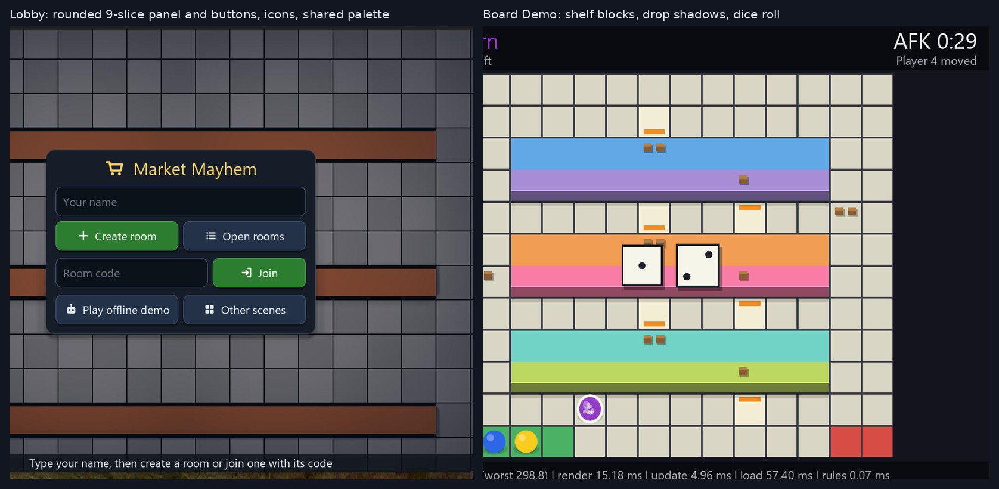
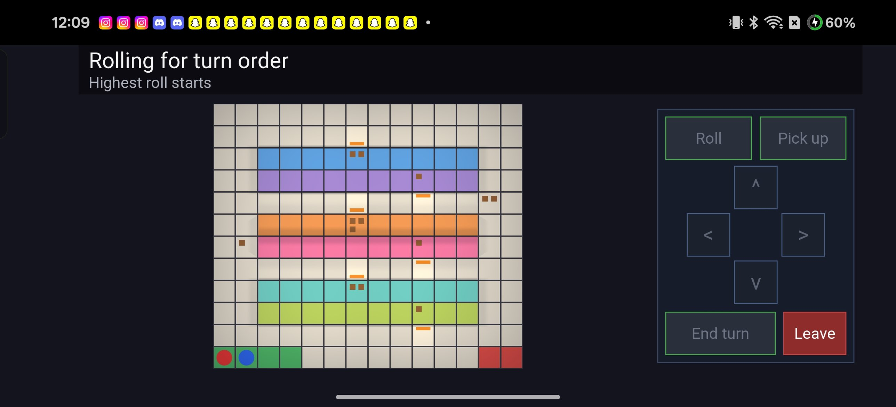
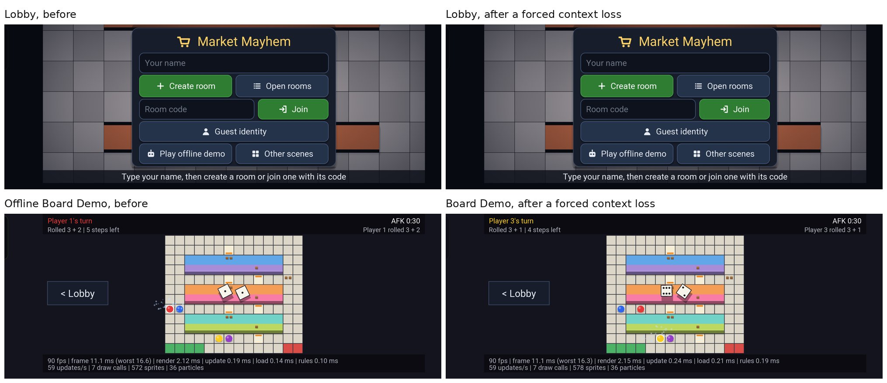
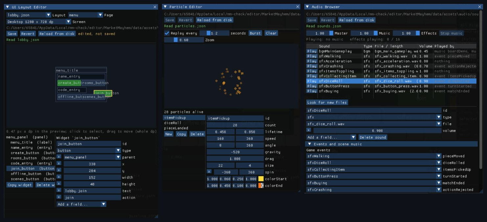

# Hi, I'm Thu Htoo San

C++ developer studying Computer Science in Real-Time Interactive Simulation at SIT and DigiPen Institute of Technology Singapore (expected 2029). I build real-time applications for Windows and Android, focusing on graphics, user interfaces and the tools around them.

## Market Mayhem (team project, Sep 2026 – present)

A multiplayer board game in our team's own C++ engine (SDL3, OpenGL 4.3 and OpenGL ES 3.0). My parts: user interface, rendering, audio, lighting, Android and editor tools. The code is in a private course repository, so here are the results:

- **Data-driven UI:** the lobby and match HUD are JSON layouts with a string table and one shared colour palette. All panels, buttons, icons and text share one texture atlas, so the whole UI draws in **1 draw call** (111–120 fps on a OnePlus 15R).
- **2D lighting and shadows:** up to 8 point lights and 16 shadow casters in the sprite shader, set in the layout files, with no extra draw calls (1.68 ms of an 11 ms frame on the phone).
- **Android context loss:** the game rebuilds its textures, shaders and buffers when Android discards the OpenGL context, tested with forced losses on the phone.
- **Editor tools (Dear ImGui):** a UI layout editor, a particle editor with live preview and an audio browser. Every save is checked by the game's own loader first.
- **Live board editing:** a board saved on the PC appears on the Android phone in about 2 s, without reinstalling the app.
- **Online lobby:** create, join and start rooms over REST and WebSocket.
- **Continuous integration:** a Jenkins Linux build that builds and tests every pull request.

### Screenshots

## Skills

C++17 · GLSL · OpenGL and OpenGL ES · SDL3 · Android NDK and Gradle · CMake · Git · Jenkins · Dear ImGui

## Contact

LinkedIn: [linkedin.com/in/thu-htoo-san](https://www.linkedin.com/in/thu-htoo-san)
